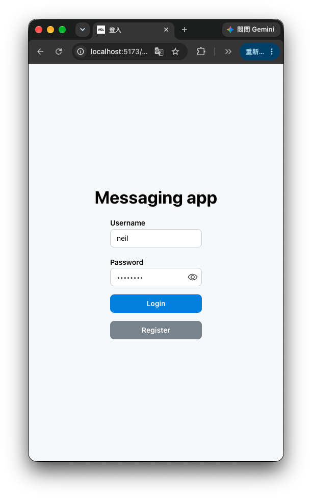
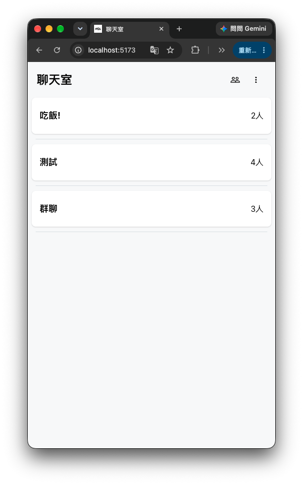
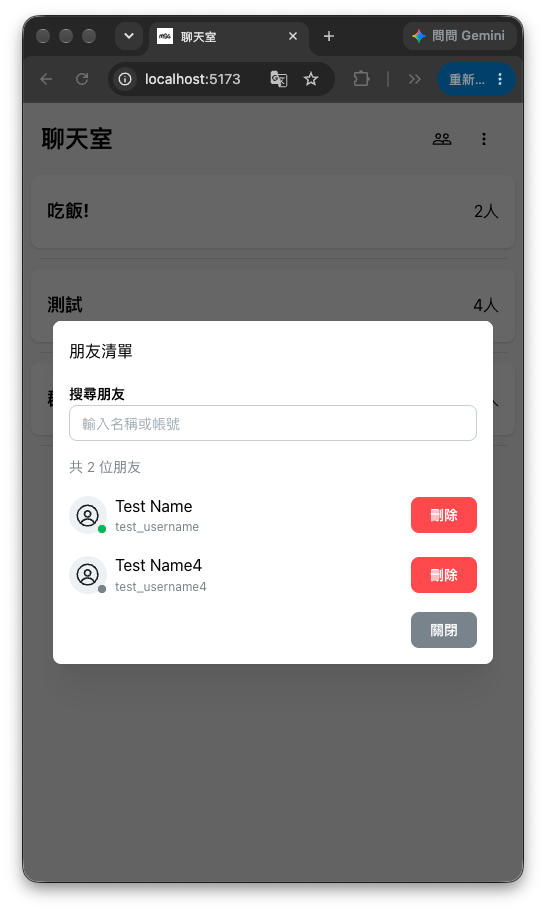
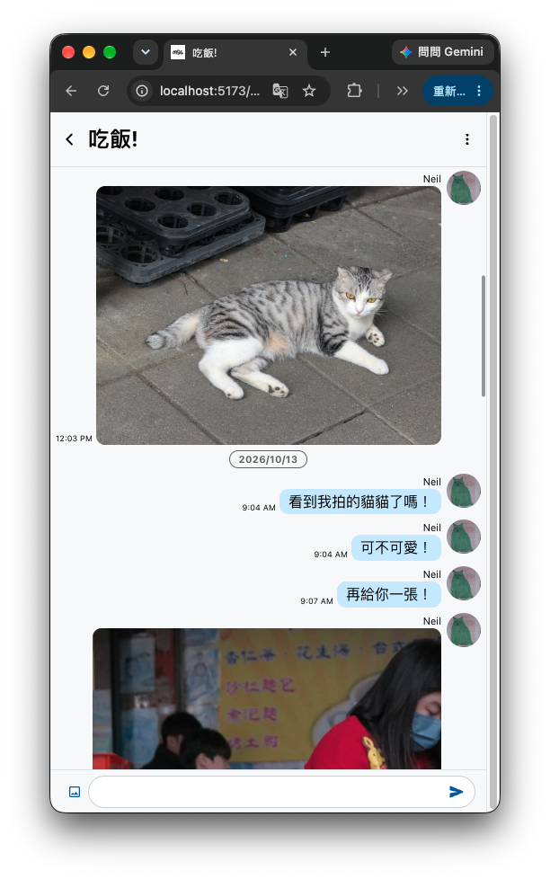
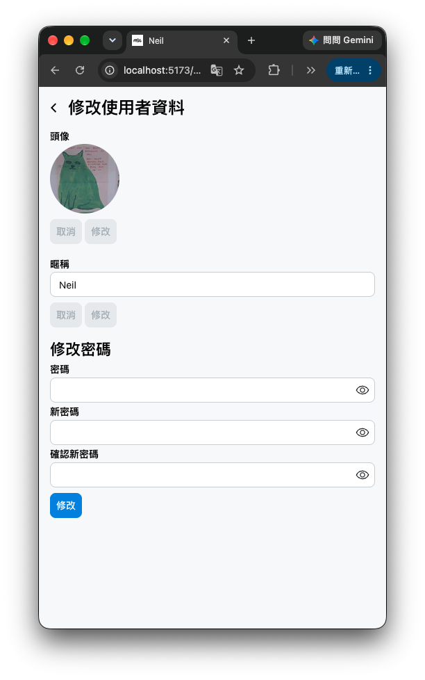

# Messaging App

聊天應用程式的前端專案，使用 React、React Router 與 TypeScript 開發，搭配 Mantine 建立介面。提供會員管理、好友邀請、多人聊天室及圖片訊息功能。

## 功能

- **會員管理**：註冊、登入、登出，以及修改暱稱、頭像與密碼。
- **好友管理**：透過帳號發送交友邀請、接受邀請、依名稱或帳號搜尋好友清單，以及刪除好友。
- **在線狀態**：登入後每 30 秒傳送心跳；開啟朋友清單時查詢在線狀態，並每 60 秒更新。
- **聊天室管理**：建立雙人或多人聊天室、查看成員、邀請好友、更改名稱、離開及刪除聊天室。邀請多人建立聊天室時需填寫名稱；邀請成員加入既有聊天室前也需先設定名稱。
- **聊天訊息**：發送文字與圖片、依日期分隔訊息，以及捲動至最新訊息。
- **圖片壓縮**：上傳前在瀏覽器壓縮圖片，頭像的最大寬高設定為 500 px，聊天圖片為 1980 px，壓縮目標皆為 1 MB。
- **表單與通知**：使用 Zod 驗證輸入，並以通知提示操作結果。

目前訊息透過 HTTP API 載入與送出，尚未整合 WebSocket、SSE 或定時拉取訊息；其他使用者的新訊息需重新載入資料後才會顯示。

## 畫面預覽

### 會員登入



### 聊天室列表



### 好友管理



### 聊天室



### 個人資料設定



## 技術組成

| 項目 | 使用技術 |
| --- | --- |
| UI 與語言 | React、TypeScript |
| 路由與建置 | React Router、Vite |
| 元件與樣式 | Mantine、CSS Modules |
| 表單驗證 | Mantine Form、Zod 4 |
| 圖示與日期 | React Icons、Day.js |
| 圖片壓縮 | browser-image-compression |
| API 請求 | Fetch API，搭配 Cookie 驗證 |

## 本機開發

### 安裝與設定

在專案根目錄安裝依賴：

```bash
npm install
```

在根目錄建立或調整 `.env`：

```dotenv
VITE_API_BASE_URL=http://localhost:3000
```

上方網址僅為範例，請替換成實際後端位址。

### 啟動

```bash
npm run dev
```

預設開發網址為 `http://localhost:5173`，實際位址以終端機輸出為準。

## 可用指令

| 指令 | 說明 |
| --- | --- |
| `npm run dev` | 啟動開發伺服器與熱更新 |

## 頁面路由

| 路徑 | 頁面 |
| --- | --- |
| `/` | 聊天室列表、好友與交友邀請管理 |
| `/register` | 會員註冊 |
| `/login` | 會員登入 |
| `/chatroom/:id` | 聊天內容與聊天室管理 |
| `/users/:id` | 目前登入使用者的資料設定 |

## 專案結構

```text
app/
├── components/           # 共用按鈕、彈窗與確認視窗
├── layouts/              # 登入狀態處理與使用者心跳
├── routes/
│   ├── home/             # 聊天室列表與好友管理
│   ├── login/            # 登入頁面
│   ├── register/         # 註冊頁面
│   ├── chatroom/         # 聊天室與訊息元件
│   └── user/             # 個人資料設定
├── services/             # API 封裝、資料型別與 Zod 驗證規則
├── utils/                # 圖片壓縮、通知與聊天室工具
├── root.tsx              # HTML 版型、Mantine Provider 與錯誤頁面
├── routes.ts             # 路由設定
└── app.css               # 全域樣式
public/                   # 靜態資源
Dockerfile                # 多階段建置與正式環境執行映像
react-router.config.ts    # React Router 設定
vite.config.ts            # Vite 外掛與路徑解析設定
```
